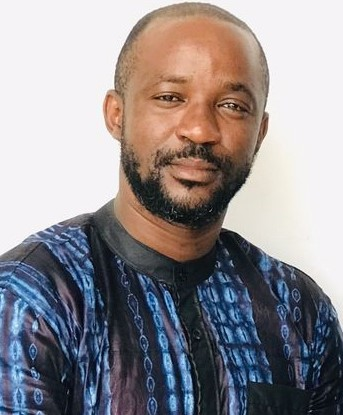

{.profile-pic fig-alt="Photo de Saa Moussa Tenguiano"}

## Présentation

Je suis étudiant à la maîtrise avec recherche en biostatistique à l'Université Laval (Québec, Canada). Mon projet de recherche porte sur **_la prise en compte de l'effet modifiant des scores de risque polygéniques lors des tests d'association de variants rares avec un trait dans des familles_**.

Avant de rejoindre l'Université Laval, j'ai étudié à l'ENSAE Dakar et à l'Université Paris Dauphine-PSL, puis j'ai travaillé comme statisticien à l'Institut National de la Statistique en Guinée et comme chargé d'enseignement à l'Université de Kindia.

## Intérêts

- Biostatistique et génétique statistique
- Programmation R et science des données
- Méthodes quantitatives au service de la décision publique

## Liens

- GitHub : <https://github.com/Tenguiano-saa>
- LinkedIn : [linkedin.com/in/saa-moussa-tenguiano](https://www.linkedin.com/in/saa-moussa-tenguiano-713b12195)
- Courriel : [saa-moussa.tenguiano.1@ulaval.ca](mailto:saa-moussa.tenguiano.1@ulaval.ca)
- Site publié : <https://tenguiano-saa.github.io/site-personnel/>

